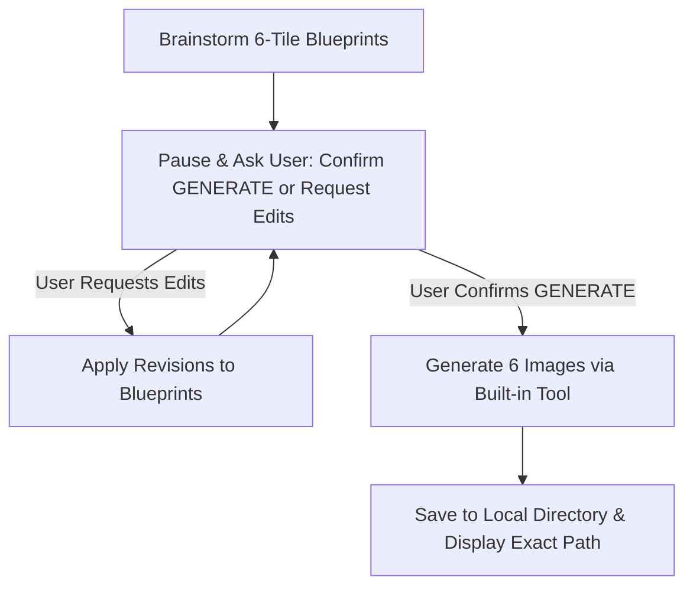

# Instagram Grid Brainstormer (`ig-grid-brainstorm`)

An **Antigravity Custom Skill** that transforms a single anchor image into an aesthetic, high-converting 6-tile Instagram profile grid (2 rows × 3 columns) with strict visual consistency rules, checkerboard feed rhythm, and built-in image generation.

---

## Key Features & Rules

### 1. Visual & Brand Consistency
- **Single Color Family**: Palette extracted from the hero product or content, maintaining a tight color family across all 6 tiles.
- **Checkerboard Rhythm**: Alternating dark and light backgrounds across adjacent tiles (e.g., Dark-Light-Dark on row 1, Light-Dark-Light on row 2) for an instantly curated look from afar.
- **Unified Typography**: A single consistent font family across all posts, varying only weights and sizes for hierarchy.
- **Product Preservation**: Core product perspective, lighting direction, materials, and proportions remain identical across every tile to anchor the campaign.

### 2. Creative Concept & Composition
- **One Overarching Theme**: All 6 tiles unite under a single campaign narrative (e.g., product drop, seasonal moment).
- **Scale & Interaction Variety**: Avoids static centered placements by distributing 4 creative styles:
  - *Hero Shot*: Full-size product interacting with surreal or miniature elements.
  - *Metaphor / Object Placement*: Scaled-down product in everyday objects (ring box, claw machine, teacup).
  - *Human Element*: Hands interacting, holding, or gesturing around the product.
  - *Minimalist Negative Space*: Scaled-down product surrounded by 70–80% clean breathing room.

### 3. Copywriting & Layout Rules
- **Micro-Copy Only**: Under 6–8 words on-image per tile.
- **Consistent Text Anchoring**: Strictly positioned (top-center, bottom-center, or card container).
- **Safe Margins**: 10–15% margin buffer from all borders to prevent profile grid cropping.

---

## Generation Workflow



1. **Review Pause**: Present the strategy and 6 post blueprints, then pause for user confirmation.
2. **Revision Loop**: Seamlessly refine angles, copy, or colors until the user replies with `GENERATE`.
3. **Automated Generation & Caption Compilation**: Invoke the native `image-generator` tool to generate the 6 image files, compile all 6 individual captions into a single `captions.txt` inside that same folder (ordered by upload sequence), and clearly display the local folder path.

---

## Directory Structure

```text
ig-grid-brainstorm/
├── SKILL.md                          # Main skill instruction file with rules & workflow
├── README.md                         # Repository documentation
├── references/
│   ├── grid-archetypes.md            # Category-specific 6-angle matrices
│   └── typography-pairings.md        # Curated font pairings by aesthetic mood
└── examples/
    └── sample-grid-output.md         # End-to-end sample run (Artisanal Coffee Roastery)
```

---

## Installation

### Global Installation (Accessible in all chats)
```bash
# Windows
git clone https://github.com/fryawhd-ctrl/ig-grid-brainstorm.git "$HOME\.gemini\config\skills\ig-grid-brainstorm"

# macOS / Linux
git clone https://github.com/fryawhd-ctrl/ig-grid-brainstorm.git ~/.gemini/config/skills/ig-grid-brainstorm
```

---

## How to Use

Provide an anchor image in chat and prompt:

> *"Here is an image: `[image path or upload]`. Brainstorm an Instagram grid for it."*
