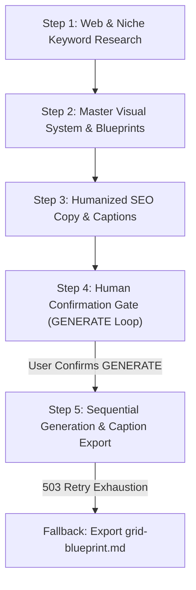

# Instagram Grid Brainstormer (`ig-grid-brainstorm`)

An **Antigravity Custom Skill** that transforms a single anchor image into an aesthetic, high-converting 6-tile Instagram profile grid (2 rows × 3 columns) with strict visual consistency rules, checkerboard feed rhythm, humanized zero-AI-slop copywriting, deep Instagram SEO funnel strategy, and automated image generation.

Refactored using **progressive disclosure** so that `SKILL.md` acts as a lean, fast, and reliable traffic controller (strictly under 250 lines) while delegating deep formatting rules to specialized references.

---

## Key Features & Rules

### 1. Visual & Brand Consistency
- **Single Color Family**: Palette extracted directly from the hero product or content (60-30-10 rule).
- **Checkerboard Rhythm**: Alternating dark and light backgrounds across adjacent tiles (e.g., Dark-Light-Dark on row 1, Light-Dark-Light on row 2) for an instantly curated look from afar.
- **Unified Typography**: A single consistent font family across all posts, varying only weights and sizes for hierarchy.
- **Product Preservation**: Core product perspective, lighting direction, materials, and proportions remain identical across every tile to anchor the campaign.
- **Safe Margins**: 10–15% margin buffer from all borders to prevent profile grid cropping.

### 2. Creative Concept & Composition
- **One Overarching Campaign Theme**: All 6 tiles unite under a single campaign narrative (e.g., product drop, seasonal moment, lifestyle movement).
- **Scale & Interaction Variety**: Distributes 4 creative styles:
  - *Hero Shot*: Full-size product interacting with surreal or miniature elements.
  - *Metaphor / Object Placement*: Scaled-down product in everyday objects (ring box, claw machine, teacup).
  - *Human Element*: Hands interacting, holding, or gesturing around the product.
  - *Minimalist Negative Space*: Scaled-down product surrounded by 70–80% clean breathing room.

### 3. Humanized Copywriting (Zero AI Slop)
Enforces rules from [`humanizer`](https://github.com/blader/humanizer) and [`no-ai-slop`](https://github.com/petergyang/no-ai-slop):
- **No Banned AI Words**: No `delve`, `foster`, `leverage`, `utilize`, `streamline`, `robust`, `cutting-edge`, `paradigm shift`, `game-changer`, `tapestry`, `realm`, `beacon`, `elevate`, `supercharge`, `harness`, or `meticulous`.
- **No Binary Contrasts**: No *"It's not X. It's Y."*—states claims directly.
- **No Colon Reveals or Em-Dash Crutches**: Eliminates fake-dramatic colons and excessive `—`.
- **Micro-Copy Limits**: On-image text strictly under 6–8 words per tile.

### 4. Deep Instagram SEO & Campaign Funnel Strategy
- **Pre-Drafting Web Research**: Runs `search_web` for real search demand, buyer intent, and trending hashtags before drafting (with offline fallback).
- **Full-Funnel Campaign Narrative**: Connects the 6 tiles across the grid:
  - *Tile 1 (Upload #6)*: Top of Funnel (Awareness & primary SEO keyword hook).
  - *Tile 2 (Upload #5)*: Mid-Funnel (Craft, materials & technical anatomy).
  - *Tile 3 (Upload #4)*: Mid-Funnel (Action guide & high-save how-to).
  - *Tile 4 (Upload #3)*: Brand Authority (Philosophy & emotional resonance).
  - *Tile 5 (Upload #2)*: Conversion (Objection handling & myth debunking).
  - *Tile 6 (Upload #1)*: Bottom of Funnel (Community discussion & direct CTA).
- **Strategic 3-Tier Hashtag Ladder (8–12 Tags per Tile)**:
  1. *Broad Category* (2–3 tags for algorithmic categorization)
  2. *Mid-Volume Niche & Buyer Intent* (4–5 tags targeting active shoppers)
  3. *Hyper-Specific / Branded* (2–3 tags for high-ranking authority)
- **Instagram SEO Alt-Text**: Included for every tile for search indexing and accessibility.

---

## 5-Step Execution Pipeline



1. **Step 1 (Research)**: Run `search_web` for live keywords and hashtags.
2. **Step 2 (Visual Blueprints)**: Reference [`references/visual-rules.md`](./references/visual-rules.md) and [`references/grid-archetypes.md`](./references/grid-archetypes.md) to define color palette, typography, and composition.
3. **Step 3 (SEO & Humanized Copy)**: Reference [`references/seo-copy-rules.md`](./references/seo-copy-rules.md), enforce `humanizer` + `no-ai-slop`, and draft on-image micro-copy + 6-post funnel captions.
4. **Step 4 (Confirmation Gate)**: Present the strategy and pause for user approval (`GENERATE` or revision requests).
5. **Step 5 (Sequential Image Generation & Export)**:
   - Generates strictly 1 final image version per tile (`tile_01.png` through `tile_06.png`) via `scripts/generate_grid.py` (if `GEMINI_API_KEY` is set) or native `image-generator`.
   - Enforces 10-second cooldown between tiles and 35-second automatic retries for 503 capacity errors.
   - Compiles all 6 captions into `captions.txt` in reverse-chronological upload order.
   - If image generation fails after 3 retries, references [`references/fallback-blueprint.md`](./references/fallback-blueprint.md) to export a self-contained `grid-blueprint.md`.

---

## Directory Structure

```text
ig-grid-brainstorm/
├── SKILL.md                          # Lean traffic controller (under 250 lines)
├── README.md                         # Repository documentation
├── scripts/
│   └── generate_grid.py              # Sequential generator with cooldown & retry logic
├── references/
│   ├── visual-rules.md               # Checkerboard rhythm, colors, typography, margins
│   ├── seo-copy-rules.md             # Web keyword research, funnel, 3-tier tags, anti-AI-slop
│   ├── fallback-blueprint.md         # grid-blueprint.md export template
│   ├── grid-archetypes.md            # 6 Universal Conceptual Lenses for avant-garde art direction
│   └── typography-pairings.md        # Curated font pairings by aesthetic mood
└── examples/
    └── sample-grid-output.md         # End-to-end sample run (Minimalist Wireless Headphones)
```

---

## Installation

### Global Installation (Accessible in all chats)
```bash
# Windows
git clone https://github.com/fryawhd-ctrl/ig-grid-brainstorm.git "$HOME\.gemini\config\skills\ig-grid-brainstorm"

# macOS / Linux
git clone https://github.com/fryawhd-ctrl/ig-grid-brainstorm.git ~/.gemini/config/skills/ig-grid-brainstorm
```

---

## How to Use

Provide an anchor image in chat and prompt:

> *"Here is an image: `[image path or upload]`. Brainstorm an Instagram grid for it."*
