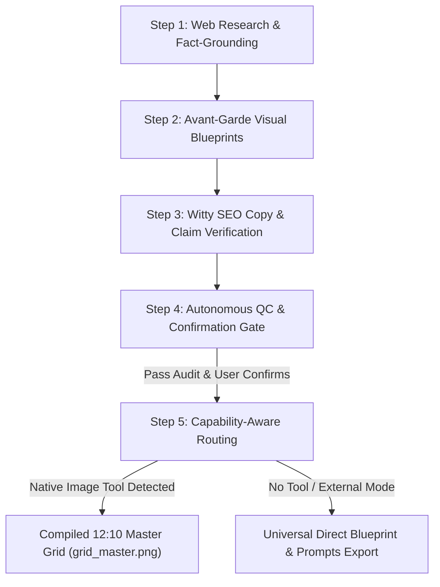

# Instagram Grid Brainstormer (`ig-grid-brainstorm`)

An **avant-garde conceptual art director skill** that transforms a single anchor product image into an aesthetic, high-converting 6-tile Instagram profile grid (2 rows × 3 columns) with strict visual consistency rules, checkerboard feed rhythm, humanized zero-AI-slop copywriting, deep Instagram SEO funnel strategy, autonomous pre-flight quality control, and capability-aware image generation.

Refactored using **progressive disclosure** so that `SKILL.md` acts as a lean, fast, and reliable traffic controller (strictly under 250 lines) while delegating deep formatting rules to specialized references.

This skill is **provider-agnostic**: it runs seamlessly across any AI agent environment (Antigravity, Claude, Gemini CLI, ChatGPT, or custom agents) without vendor lock-in, skipping stages, or dropping captions.

---

## Key Features & Rules

### 1. Avant-Garde Visual & Brand Consistency
- **Strict 2–3 Color Palette**: Extracted directly from the hero product (1 dominant dark/saturated tone, 1 light/clean background tone, 1 vibrant accent).
- **Checkerboard Rhythm**: Alternating dark and light backgrounds across adjacent tiles (Row 1: Dark-Light-Dark, Row 2: Light-Dark-Light) for immediate high-contrast profile curation from afar.
- **Unified Graphic Typography**: A single consistent font family across all posts, using typography as an architectural design element (curved halo text, split punchlines, UI badges, overlapping oversized letters).
- **Extreme Scale Variance**: Enforces dramatic scale shifts across the 6 tiles—ranging from full-bleed macro details to tiny compositions where the product occupies <15% of the frame surrounded by vast negative space.
- **Zero "Product-on-a-Table" Repetition**: Strict ban on default catalog podiums, tabletop flat-lays, and repeated camera angles. The product is 100% physically preserved, while its environment is surreal and conceptual.
- **Safe Margins**: 10–15% margin buffer from all borders to prevent profile grid cropping.

### 2. Universal Conceptual Lenses
Applicable to any physical product category (tech, beauty/skincare, fashion, home goods, or beverages) through 6 non-sequential creative lenses:
1. *Scale & Physics Distortion*: Giant monuments with miniature figures, or zero-G suspension defying gravity.
2. *Surreal Container & Context Swap*: Shrunk inside unexpected everyday containers (velvet ring box, arcade claw machine, emergency glass box).
3. *Kinetic Human POV*: Dynamic hands holding, catching, or gesturing in motion (no resting tabletops).
4. *Typographic Architecture*: Type wraps around objects, splits top/bottom, or sits behind as oversized graphic art.
5. *Screen-Native & UI Play*: Integrated digital UI elements (chat bubbles, battery indicators, OS notification banners).
6. *Extreme Negative Space Whisper*: Shrunk to <15% scale off-center in 85%+ solid breathing room.

### 3. Humanized Copywriting (Zero AI Slop)
Enforces rules from [`humanizer`](https://github.com/blader/humanizer) and [`no-ai-slop`](https://github.com/petergyang/no-ai-slop):
- **No Banned AI Words**: No `delve`, `foster`, `leverage`, `utilize`, `streamline`, `robust`, `cutting-edge`, `paradigm shift`, `game-changer`, `tapestry`, `realm`, `beacon`, `elevate`, `supercharge`, `harness`, or `meticulous`.
- **No Binary Contrasts**: No *"It's not X. It's Y."*—states claims directly.
- **No Colon Reveals or Em-Dash Crutches**: Eliminates fake-dramatic colons and excessive `—`.
- **Micro-Copy Limits**: On-image text strictly **under 6 words** per tile.

### 4. Deep Instagram SEO & Campaign Funnel Strategy
- **Pre-Drafting Web Research**: Researches live search demand, buyer intent, and trending hashtags before drafting (with offline domain knowledge fallback).
- **Full-Funnel Campaign Narrative**: Connects the 6 tiles across the grid:
  - *Tile 1 (Upload #6)*: Top of Funnel (Awareness & primary SEO keyword hook).
  - *Tile 2 (Upload #5)*: Mid-Funnel (Craft, materials & technical anatomy).
  - *Tile 3 (Upload #4)*: Mid-Funnel (Action guide & high-save how-to).
  - *Tile 4 (Upload #3)*: Brand Authority (Philosophy & emotional resonance).
  - *Tile 5 (Upload #2)*: Conversion (Objection handling & myth debunking).
  - *Tile 6 (Upload #1)*: Bottom of Funnel (Community discussion & direct CTA).
- **Strategic 3-Tier Hashtag Ladder (8–12 Tags per Tile)**:
  1. *Broad Category* (2–3 tags for algorithmic categorization)
  2. *Mid-Volume Niche & Buyer Intent* (4–5 tags targeting active shoppers)
  3. *Hyper-Specific / Branded* (2–3 tags for high-ranking authority)
- **Instagram SEO Alt-Text**: Included for every tile for search indexing and accessibility.

### 5. Universal Factual Grounding & Claim Verification Gate
- **Visuals Own the Metaphor, Copy Owns the Truth**: Surreal exaggeration is restricted strictly to visual art direction; headlines, micro-copy, and captions remain 100% factually grounded.
- **Cross-Domain Verified Fact Sheet**: Ingests and verifies official specs, ingredients, dietary/allergen safety, IP ratings, thermal limits, origins, and scientific mechanisms in Step 1.
- **Zero Unverified Claims**: Forbids extrapolating standard tests into extreme claims (e.g. turning -20°C to 50°C into "cryo-tested") or assuming dietary statuses (gluten-free, halal, vegan) without explicit verification.
- **Strict Non-Speculation Fallback**: Automatically rewrites unverified technical details into purely sensory, emotional, or lifestyle phrasing.

### 6. Autonomous Quality Control (Zero-Human-Interference Gate)
- **Zero Skipped Stages**: Mandates completion of Research, Visual Blueprints, and Copywriting before image prompts are generated.
- **Strict 3×2 Cardinality**: Enforces exactly 6 tiles with reverse-chronological upload mapping.
- **100% Full Captions**: Prevents models from summarizing or omitting captions; every tile must include hook (<125 chars), value narrative, CTA, 8–12 three-tier hashtags, and Alt-Text.
- **Factual Integrity Assertion**: Audits all claims against the Verified Fact Sheet prior to human presentation.
- **Self-Healing Loop**: If any check fails, the model silently self-corrects prior to user presentation.
- **Deterministic CLI Validator**: Includes `scripts/validate_grid.py` to programmatically assert compliance gates in automated CI/CD pipelines or terminal workflows.

---

## 5-Step Execution Pipeline



1. **Step 1 (Research & Fact-Grounding)**: Research live trending keywords, search intent, and compile a domain-relevant Verified Fact Sheet (ingredients, allergens, official hardware specs, ratings, origins).
2. **Step 2 (Visual Blueprints)**: Reference [`references/visual-rules.md`](./references/visual-rules.md), [`references/grid-archetypes.md`](./references/grid-archetypes.md), and [`references/visual-benchmarks.md`](./references/visual-benchmarks.md) to define color palette, typography architecture, spatial mechanics, and 6 surreal concepts.
3. **Step 3 (SEO Copy & Claim Verification)**: Reference [`references/seo-copy-rules.md`](./references/seo-copy-rules.md), enforce `humanizer` + `no-ai-slop`, audit all assertions against the Fact Sheet (rewriting unverified specs to sensory/lifestyle phrasing), and draft on-image micro-copy (<6 words) + 6-post funnel captions.
4. **Step 4 (Autonomous QC & Confirmation Gate)**:
   - Evaluates internal compliance against [`references/quality-control.md`](./references/quality-control.md).
   - Verifies 7 gates: anti-skipping, 3×2 layout & 12:10 master grid proportions, full captions, checkerboard contrast, scale diversity, micro-copy length, and factual claim integrity. Self-heals any defects.
   - Presents the verified master system and pauses for user approval (`GENERATE` or revision requests).
5. **Step 5 (Capability-Aware Routing)**:
   - **Branch A (Native Tool Available)**: Generates 1 single compiled 3×2 master grid image (`grid_master.png`) in exact 12:10 (6:5) proportions with 1px–2px neutral hairline dividers and anti-cropping guardrails. Compiles `captions.txt` and preserves individual 4:5 prompts in `grid-blueprint.md`.
   - **Branch B (Universal Direct Export)**: If running in environments without image tools or if generation fails, references [`references/fallback-blueprint.md`](./references/fallback-blueprint.md) to immediately output the unified 12:10 Master Grid Prompt, the 6 individual 4:5 tile prompts, reverse-chronological `captions.txt`, and 3x2 matrix directly in the response for instant use in Google Flow, Midjourney, ChatGPT, Gemini, Ideogram, or Flux.

---

## Directory Structure

```text
ig-grid-brainstorm/
├── SKILL.md                          # Lean traffic controller (under 250 lines)
├── README.md                         # Repository documentation
├── scripts/
│   ├── generate_grid.py              # Optional local generator script with cooldown & retry logic
│   └── validate_grid.py              # Deterministic QC validator for CI/CD and scripts
├── references/
│   ├── quality-control.md            # Autonomous self-audit rubric, gates, and self-healing directives
│   ├── visual-rules.md               # Avant-garde art direction, checkerboard, scale, typography
│   ├── visual-benchmarks.md          # Structural DNA, spatial mechanics, and graphic devices
│   ├── seo-copy-rules.md             # Keyword research, funnel narrative, 3-tier tags, anti-slop
│   ├── fallback-blueprint.md         # Universal direct export template (Midjourney, ChatGPT, Gemini, Flux)
│   ├── grid-archetypes.md            # 6 Universal Conceptual Lenses for avant-garde art direction
│   └── typography-pairings.md        # Curated font pairings by aesthetic mood
└── examples/
    └── sample-grid-output.md         # End-to-end sample run (Minimalist Wireless Headphones)
```

---

## Installation

### Global Installation (Accessible in all chats)
```bash
# Windows
git clone https://github.com/fryawhd-ctrl/ig-grid-brainstorm.git "$HOME\.gemini\config\skills\ig-grid-brainstorm"

# macOS / Linux
git clone https://github.com/fryawhd-ctrl/ig-grid-brainstorm.git ~/.gemini/config/skills/ig-grid-brainstorm
```

---

## How to Use

Provide an anchor image in chat and prompt:

> *"Here is an image: `[image path or upload]`. Brainstorm an Instagram grid for it."*
