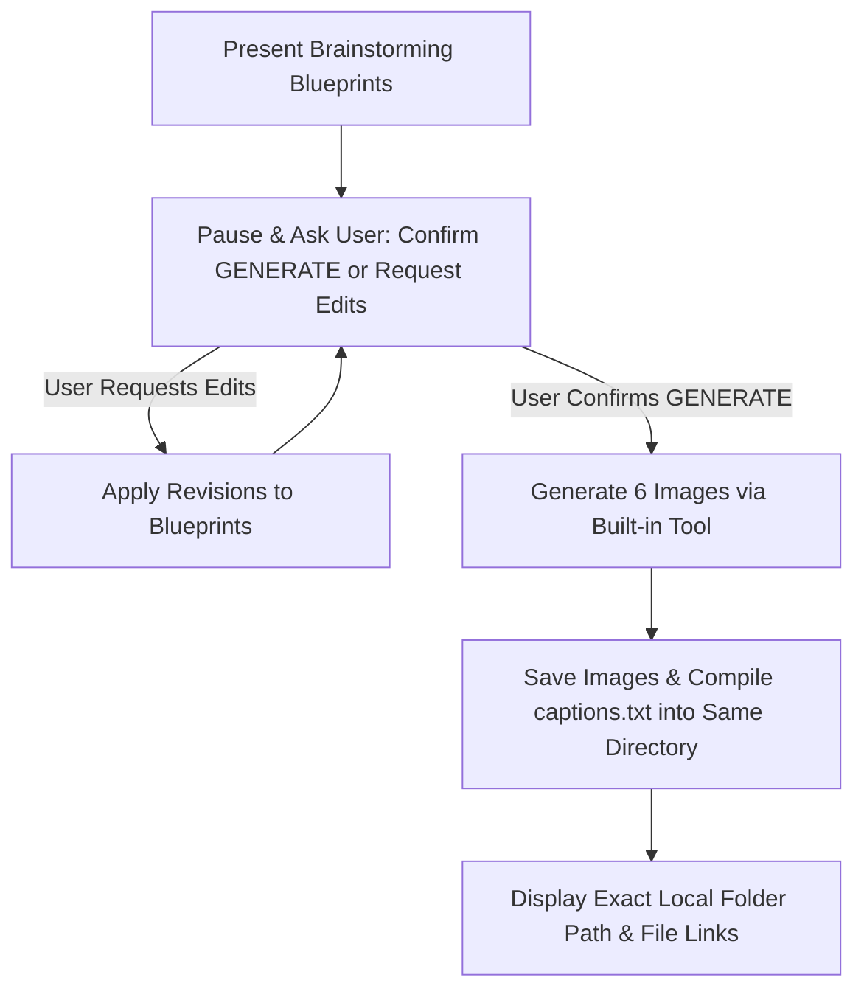

# Instagram Grid Brainstormer (`ig-grid-brainstorm`)

Transform a single anchor image into an aesthetic, high-converting 6-tile Instagram profile grid (2 rows × 3 columns) adhering to strict visual consistency rules, checkerboard feed rhythm, and an interactive revision-to-generation workflow.

---

## 1. Visual & Brand Consistency Rules

Every 6-tile grid brainstorm must strictly enforce these four visual rules:

1. **Color Palette (Single Color Family)**:
   - Limit the entire 6-post grid to the same cohesive color family.
   - Extract the palette directly from the hero product or anchor image (Primary Base, Secondary, Accent, Dark Neutral, Light Neutral).
2. **Checkerboard Rhythm (Contrast Balance)**:
   - Alternate background values across adjacent tiles so the 3×2 grid looks balanced, curated, and dynamic from a distance on the profile feed:
     - **Row 1 (Top Row)**: `[ Dark Background ]` — `[ Light Background ]` — `[ Dark Background ]`
     - **Row 2 (Bottom Row)**: `[ Light Background ]` — `[ Dark Background ]` — `[ Light Background ]`
     *(Or vice versa: Light-Dark-Light on Row 1 and Dark-Light-Dark on Row 2).*
3. **Unified Typography (Single Font Family)**:
   - Use **one consistent font family** across all 6 posts.
   - Vary **only weight** (e.g., Bold / Black vs. Regular / Medium) and **size** to establish visual hierarchy without introducing competing typefaces.
4. **Product Preservation (Visual Anchor)**:
   - Keep the core product's lighting direction, perspective angle, materials, and proportions identical across all tiles so it serves as the recognizable anchor.
   - Alter only the product's **scale** or the **environmental context** surrounding it.

---

## 2. Creative Concept & Composition Rules

1. **One Theme, Six Angles**:
   - Tie all six posts to a single overarching campaign theme (e.g., product launch, seasonal campaign, Valentine's Day, summer drop) rather than treating them as 6 disconnected ads.
2. **Vary Scale & Interaction Across Tiles**:
   - Never place the product dead-center at the exact same scale in every frame. Distribute these four compositional treatments across the 6 tiles:
     - **Hero Shot**: Full-size product interacting with miniature or surreal elements.
     - **Metaphor / Object Placement**: Place the scaled-down product inside an unexpected everyday container (e.g., ring box, claw machine, teacup, book).
     - **Human Element**: Hands holding, clinking, or gesturing around the product to bring warmth, scale, and relatability.
     - **Minimalist Negative Space**: Shrink the product significantly and surround it with 70–80% clean breathing space (paired with a tiny text bubble or minimal icon) to give the eye a rest.

---

## 3. Copywriting & Layout Rules

1. **Micro-Copy Only (On-Image Text)**:
   - Keep on-image text strictly under **6–8 words per tile**.
   - Let the visual metaphor carry the visual impact; leave deeper storytelling and details to the caption.
2. **Balanced Text Placement**:
   - Anchor text consistently across the set: strictly top-center, strictly bottom-center, or integrated into a designated card/badge container.
3. **Safe Margins (10–15% Buffer)**:
   - Keep all text, logos, and key visual elements at least **10–15% away from every edge** of the square/vertical canvas so nothing gets cropped in the Instagram profile grid view.

---

## 4. Grid Architecture & Upload Sequencing

Instagram displays profile feeds in 3 columns. The 6 posts span two complete rows:

```text
+-------------------+-------------------+-------------------+
|      TILE 1       |      TILE 2       |      TILE 3       |  <-- ROW 1 (Top Row on Profile)
|    [Top-Left]     |   [Top-Center]    |    [Top-Right]    |
+-------------------+-------------------+-------------------+
|      TILE 4       |      TILE 5       |      TILE 6       |  <-- ROW 2 (Bottom Row on Profile)
|   [Bottom-Left]   |  [Bottom-Center]  |  [Bottom-Right]   |
+-------------------+-------------------+-------------------+
```

### Reverse-Chronological Upload Sequence
To ensure the profile grid renders properly as newer uploads push older posts to the right and down:
1. **Upload #1** ➔ **Tile 6** (Bottom-Right)
2. **Upload #2** ➔ **Tile 5** (Bottom-Center)
3. **Upload #3** ➔ **Tile 4** (Bottom-Left)
4. **Upload #4** ➔ **Tile 3** (Top-Right)
5. **Upload #5** ➔ **Tile 2** (Top-Center)
6. **Upload #6** ➔ **Tile 1** (Top-Left)

---

## 5. Output Blueprint Schema (Per Tile)

For each tile (1 to 6), output:

```markdown
### Tile [N]: [Catchy Name]
- **Grid Position**: [Row X, Col Y] | **Upload Order**: Upload #[M] of 6
- **Composition Style**: [Hero / Metaphor Placement / Human Element / Minimal Negative Space]
- **Background Tone**: [Dark / Light] (Checkerboard Rhythm)

#### Visual & Graphic Direction
- **Product Scale & Context**: [Scale % and environment description]
- **Lighting & Perspective**: [Preserved from anchor image]
- **Background & Color Distribution**: [Exact hex color codes used]
- **On-Image Micro-Copy**: "[Max 6-8 words]" ([Font Family], [Weight], [Placement: Top-Center / Bottom-Center])
- **Safe Margin Verification**: [Confirmed 10-15% boundary compliance]

#### Individual Caption (Minimalist High-Converting Formula)
**[Hook Line <125 characters that stops the scroll before the 'more' fold]**

[1-3 concise, punchy paragraphs or bullet points delivering immediate takeaway/context]

[Clear single-action CTA or engagement question]

---
**Hashtags**: #[tag1] #[tag2] #[tag3] #[tag4] #[tag5] #[tag6] #[tag7]
**Instagram Alt-Text**: [Descriptive, SEO-rich visual description for accessibility]
```

---

## 6. Post-Brainstorming Workflow & Image Generation Loop

Follow these exact steps after completing the brainstorm:



### Step 1: Brainstorming & Review Pause
- Present the 3x2 Grid Matrix, color palette, font family, and all 6 tile blueprints.
- **Stop and ask the user to confirm or request revisions**:
  > *"Please review the brainstormed grid strategy and blueprints above. Reply with **GENERATE** to proceed with generating all 6 images natively, or let me know any revisions or adjustments you'd like to make."*

### Step 2: Interactive Revision Loop
- If the user requests corrections or changes:
  1. Apply the revisions directly to the blueprints.
  2. Maintain the visual rules (checkerboard rhythm, unified font family, product preservation, micro-copy under 8 words, safe margins).
  3. Pause and ask the user again to confirm (`"GENERATE"`) or request further edits.
  4. Repeat this loop until the user approves.

### Step 3: Native Image Generation & Caption Compilation (Upon "GENERATE" Approval)
- When the user approves with `"GENERATE"` (or equivalent confirmation):
  1. Invoke the built-in `image-generator` subagent for each of the 6 tiles using the detailed visual prompts established in the blueprints.
  2. Ensure prompts enforce the checkerboard background value, product consistency, scale variation, safe margins, and on-image micro-copy.
  3. Save the 6 generated images into a structured local directory on the user's machine (e.g., `<Artifact Directory Path>/generated_grid/` or `<Workspace>/generated_grid/`).
  4. **Compile All 6 Captions into a Single `captions.txt` File**:
     - Inside that exact same image generation directory, write a single `captions.txt` file containing all 6 captions.
     - Structure the file cleanly, ordered by reverse-chronological upload sequence (**Upload #1 through Upload #6**):
       ```text
       ================================================================================
       UPLOAD #1 (TILE 6 - Bottom-Right)
       Title: [Catchy Tile Name]
       On-Image Text: "[Micro-Copy Text]"
       --------------------------------------------------------------------------------
       CAPTION:
       [Full Caption Text]
       
       HASHTAGS:
       #[tag1] #[tag2] #[tag3] ...
       
       ALT-TEXT:
       [Instagram SEO Alt-Text Description]
       ================================================================================
       ```
     - This allows effortless copy-pasting during scheduling or manual publishing.
  5. **Display the exact local folder path** clearly to the user with clickable `file://` links for each generated image file and the compiled `captions.txt` file.
