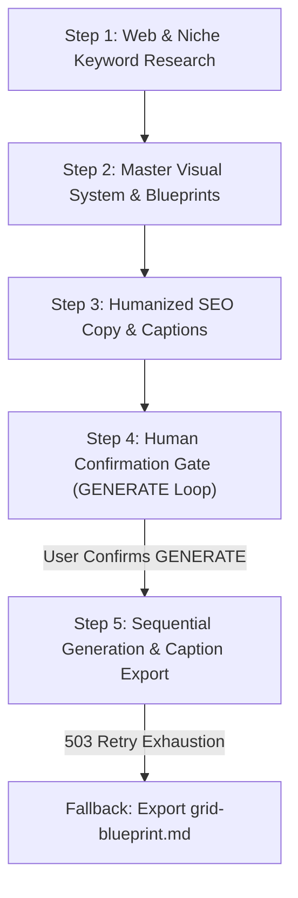

# Instagram Grid Brainstormer (`ig-grid-brainstorm`)

Transform a single anchor image into a curated, high-converting 6-tile Instagram profile grid (2 rows × 3 columns). This skill operates as an orchestration controller, using progressive disclosure to reference specialized design, SEO, and copywriting rules.

---

## 3x2 Grid Architecture & Posting Sequence

Instagram feeds display posts in 3 columns. The 6 posts span two complete rows:

```text
+-------------------+-------------------+-------------------+
|      TILE 1       |      TILE 2       |      TILE 3       |  <-- ROW 1 (Top Row on Profile)
|    [Top-Left]     |   [Top-Center]    |    [Top-Right]    |
+-------------------+-------------------+-------------------+
|      TILE 4       |      TILE 5       |      TILE 6       |  <-- ROW 2 (Bottom Row on Profile)
|   [Bottom-Left]   |  [Bottom-Center]  |  [Bottom-Right]   |
+-------------------+-------------------+-------------------+
```

### Reverse-Chronological Upload Sequence
Because newer uploads push older posts to the right and down, upload in this exact order:
1. **Upload #1** ➔ **Tile 6** (Bottom-Right)
2. **Upload #2** ➔ **Tile 5** (Bottom-Center)
3. **Upload #3** ➔ **Tile 4** (Bottom-Left)
4. **Upload #4** ➔ **Tile 3** (Top-Right)
5. **Upload #5** ➔ **Tile 2** (Top-Center)
6. **Upload #6** ➔ **Tile 1** (Top-Left)

---

## The 5-Step Execution Pipeline



### Step 1: Research (Keywords & Market Context)
1. Ingest the user's anchor image, product concept, or visual file.
2. Run `search_web` to discover live search demand:
   - Query: `"[niche/product] instagram trending keywords hashtags"` and `"[niche] buyer pain points"`
   - Identify: Primary high-volume keyword, secondary long-tail queries, and buyer motivations.
3. *Offline Fallback*: If search is unavailable, use domain expertise to extract core category nouns, high-intent modifier phrases, and solution hooks.

### Step 2: Visual Blueprints & Master Design System
1. Read **[references/visual-rules.md](./references/visual-rules.md)** and **[references/grid-archetypes.md](./references/grid-archetypes.md)**.
2. Define the campaign visual system:
   - **Color Palette (60-30-10 Rule)**: Extract 5 hex codes (Primary Base, Secondary, Accent, Dark/Light neutrals) from the anchor image.
   - **Checkerboard Rhythm**: Enforce alternating dark/light backgrounds (Row 1: Dark-Light-Dark; Row 2: Light-Dark-Light, or inverse).
   - **Unified Typography**: Select **one font family** for the whole campaign, varying weight and size for hierarchy (see [references/typography-pairings.md](./references/typography-pairings.md)).
   - **Product Preservation**: Lock lighting, angle, and proportions; alter only scale and environment.
   - **Scale & Interaction Variety**: Distribute the 4 core styles (Hero Shot, Metaphor Placement, Human Element, Minimal Negative Space).
   - **Safe Margins**: Maintain 10–15% margin buffer from outer edges.

### Step 3: SEO & Humanized Copywriting
1. Read **[references/seo-copy-rules.md](./references/seo-copy-rules.md)**.
2. Apply writing guidelines from `~/.gemini/config/skills/humanizer/SKILL.md` and `~/.gemini/config/skills/no-ai-slop/SKILL.md` (or the inline anti-slop rules in `seo-copy-rules.md`):
   - Strip AI clichés, binary contrasts (*"It's not X. It's Y."*), colon reveals, and em-dash crutches.
3. Draft copy for all 6 tiles following the campaign marketing funnel:
   - **On-Image Micro-Copy**: Strictly under **6–8 words** per tile.
   - **Opening Hook (<125 chars)**: Weave primary keywords naturally before the "more" truncation point.
   - **Full-Funnel Narrative Arc**: Awareness (Tile 1) ➔ Craft (Tile 2) ➔ Action Guide (Tile 3) ➔ Philosophy (Tile 4) ➔ Objection Bust (Tile 5) ➔ Direct CTA (Tile 6).
   - **Strategic 3-Tier Hashtags**: Curate 8–12 tags per tile (2–3 Broad, 4–5 Mid-Volume Niche, 2–3 Hyper-Specific/Branded).
   - **Instagram SEO Alt-Text**: Provide descriptive visual search text per tile.

### Step 4: Human Confirmation Gate
1. Present the master visual system, 3x2 matrix map, and 6 complete post blueprints.
2. **Pause and prompt the user**:
   > *"Please review the brainstormed grid strategy, blueprints, and captions above. Reply with **GENERATE** to create the images, or let me know any revisions you would like to make."*
3. *Revision Loop*: If the user requests edits, apply changes and ask again until approval is received.

### Step 5: Sequential Image Generation & Export
When the user confirms with `"GENERATE"`:
1. **Strictly 1 Final Image Per Tile**:
   - Generate exactly 1 image per tile (`tile_01.png` through `tile_06.png`). Never generate candidate drafts or parallel variations.
2. **Execution Method**:
   - If `GEMINI_API_KEY` is present: Run `python scripts/generate_grid.py --config <path_to_config.json>`.
   - Otherwise: Sequentially invoke the native `image-generator` subagent for each tile.
3. **Rate-Limit & Capacity Protection**:
   - Pause **10 seconds** between successful image generations.
   - If a `503` or `MODEL_CAPACITY_EXHAUSTED` error occurs: Do not abort. Pause **35 seconds** and retry (up to 3 attempts per tile).
4. **Compile `captions.txt` & Local Path Display**:
   - Compile all 6 captions in reverse-chronological upload order (Upload #1 to #6) into `captions.txt` inside the image folder.
   - Display the **exact local directory path** with clickable `file://` links to each image and `captions.txt`.
5. **Graceful Fallback Export (If Generation Fails)**:
   - If generation fails after 3 retries or tools are unavailable, ask the user:
     > *"Image generation is currently unavailable after multiple attempts. Would you like me to export a complete downloadable blueprint so you can generate these 6 tiles in Gemini, ChatGPT, or Midjourney?"*
   - Upon confirmation, read **[references/fallback-blueprint.md](./references/fallback-blueprint.md)** and export a self-contained `grid-blueprint.md` alongside `captions.txt`.

---

## Skill References

- **[Visual Rules](./references/visual-rules.md)**: Checkerboard rhythm, color palette, single font family, product preservation, and safe margins.
- **[SEO & Copy Rules](./references/seo-copy-rules.md)**: Web research, funnel narrative, 3-tier hashtags, humanizer / no-ai-slop rules, and `captions.txt` template.
- **[Fallback Blueprint](./references/fallback-blueprint.md)**: Export template for `grid-blueprint.md` when generation tools are unavailable.
- **[Typography Pairings](./references/typography-pairings.md)**: Curated font pairings by aesthetic mood.
- **[Grid Archetypes](./references/grid-archetypes.md)**: Category-specific 6-angle matrix variations.
- **[Sample Grid Output](./examples/sample-grid-output.md)**: End-to-end coffee roastery grid demonstration.
