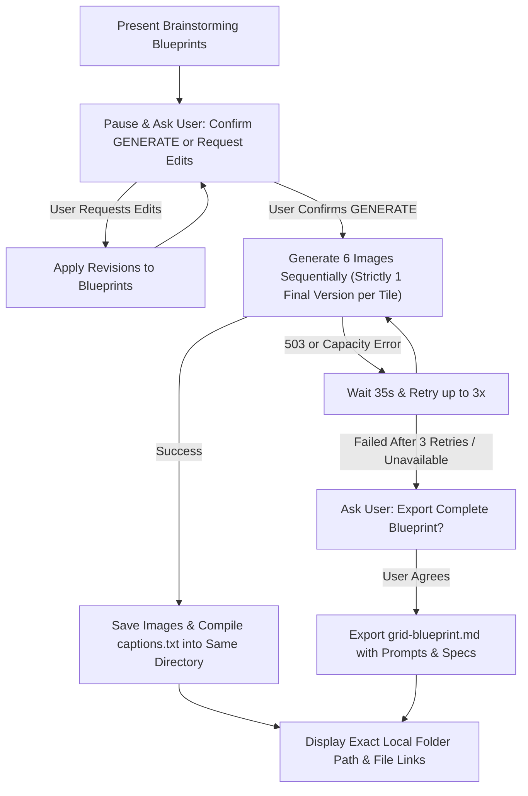

# Instagram Grid Brainstormer (`ig-grid-brainstorm`)

Transform a single anchor image into an aesthetic, high-converting 6-tile Instagram profile grid (2 rows × 3 columns) adhering to strict visual consistency rules, checkerboard feed rhythm, humanized copywriting (zero AI slop), campaign-wide Instagram SEO funnel strategy, and an interactive revision-to-generation workflow.

---

## 1. Visual & Brand Consistency Rules

Every 6-tile grid brainstorm must strictly enforce these four visual rules:

1. **Color Palette (Single Color Family)**:
   - Limit the entire 6-post grid to the same cohesive color family.
   - Extract the palette directly from the hero product or anchor image (Primary Base, Secondary, Accent, Dark Neutral, Light Neutral).
2. **Checkerboard Rhythm (Contrast Balance)**:
   - Alternate background values across adjacent tiles so the 3×2 grid looks balanced, curated, and dynamic from a distance on the profile feed:
     - **Row 1 (Top Row)**: `[ Dark Background ]` — `[ Light Background ]` — `[ Dark Background ]`
     - **Row 2 (Bottom Row)**: `[ Light Background ]` — `[ Dark Background ]` — `[ Light Background ]`
     *(Or vice versa: Light-Dark-Light on Row 1 and Dark-Light-Dark on Row 2).*
3. **Unified Typography (Single Font Family)**:
   - Use **one consistent font family** across all 6 posts.
   - Vary **only weight** (e.g., Bold / Black vs. Regular / Medium) and **size** to establish visual hierarchy without introducing competing typefaces.
4. **Product Preservation (Visual Anchor)**:
   - Keep the core product's lighting direction, perspective angle, materials, and proportions identical across all tiles so it serves as the recognizable anchor.
   - Alter only the product's **scale** or the **environmental context** surrounding it.

---

## 2. Creative Concept & Composition Rules

1. **One Overarching Campaign Theme**:
   - Tie all six posts to a single campaign narrative (e.g., product launch, seasonal moment, lifestyle movement) rather than treating them as 6 disconnected ads.
2. **Vary Scale & Interaction Across Tiles**:
   - Never place the product dead-center at the exact same scale in every frame. Distribute these four compositional treatments across the 6 tiles:
     - **Hero Shot**: Full-size product interacting with miniature or surreal elements.
     - **Metaphor / Object Placement**: Place the scaled-down product inside an unexpected everyday container (e.g., ring box, claw machine, teacup, book).
     - **Human Element**: Hands holding, clinking, or gesturing around the product to bring warmth, scale, and relatability.
     - **Minimalist Negative Space**: Shrink the product significantly and surround it with 70–80% clean breathing space (paired with a tiny text bubble or minimal icon) to give the eye a rest.

---

## 3. Copywriting, Humanization & Zero-AI-Slop Rules

All written copy—both **On-Image Micro-Copy** and **Instagram Captions**—must sound human, sharp, and authentic.

### Mandatory Skill Enforcement
Whenever drafting micro-copy or caption text, actively read and apply the rules from:
- `~/.gemini/config/skills/humanizer/SKILL.md`
- `~/.gemini/config/skills/no-ai-slop/SKILL.md`

### Inline Anti-AI-Slop Fallback (Always Enforce)
Even if running in an environment without the local skill files above, enforce these strict guidelines:

1. **Banned AI Words & Buzzwords**:
   - Never use: `delve`, `foster`, `leverage`, `utilize`, `streamline`, `robust`, `cutting-edge`, `paradigm shift`, `game-changer`, `tapestry`, `realm`, `beacon`, `elevate`, `supercharge`, `harness`, `meticulous`, `ever-evolving`, `transformative`, `multifaceted`.
2. **Banned Binary Contrasts ("Not X, but Y")**:
   - Never write: *"It's not just a coffee. It's a ritual"* or *"This isn't about productivity, it's about peace."*
   - Fix: State the claim directly: *"A 15-gram pour-over changes the morning."*
3. **Banned Colon Reveals & Faux-Drama**:
   - Never write: *"The secret: it brews in 3 minutes"* or *"The best part: it learns."*
   - Fix: Use standard sentence structures: *"It brews in three minutes."*
4. **Banned Em-Dash Crutches**:
   - Do not use em-dashes (`—`) as an automatic sentence bridge or rhythm crutch. Use clean periods or natural commas instead.
5. **Banned Fake-Insight Setups & Kickers**:
   - Cut: *"Here's what nobody tells you,"* *"What most people get wrong:"*
   - Cut mic-drop endings: *"Read that again."* or *"Let that sink in."*
6. **On-Image Micro-Copy Limits**:
   - Keep on-image text strictly under **6–8 words per tile**.
   - Anchor text consistently (strictly top-center, bottom-center, or a designated badge).
   - Safe margins: Keep text and focal points at least **10–15% away from canvas edges** to prevent profile grid cropping.

---

## 4. Deep Instagram SEO & Marketing Funnel Strategy

Captions are not mere literal descriptions of what is visible in a tile. They are **SEO-engineered marketing assets** that form a cohesive campaign funnel.

Refer to [Instagram SEO & Marketing Guide](./references/instagram-seo-guide.md) for deep-dive methodology.

### 1. Pre-Drafting Research Protocol
Before drafting, identify:
- **Primary Search Keyword**: Category-level search term that real buyers type into Instagram (e.g., `Specialty Coffee Roaster`).
- **Secondary Long-Tail Phrases**: High-intent, problem/solution queries (e.g., `V60 brew ratio`, `Ethiopian washed beans`, `morning coffee routine`).
- **Buyer Intent & Cultural Context**: Pain points with inferior alternatives, seasonal relevance, and lifestyle aspiration.

### 2. The 6-Post Funnel Narrative Arc
Distribute the narrative across the 6 tiles so the grid acts as an integrated marketing journey:
- **Tile 1 (Top-Left / Upload #6) - Top of Funnel (Awareness)**:
  - Big vision hook containing the primary high-volume SEO keyword. Universal aspiration.
- **Tile 2 (Top-Center / Upload #5) - Mid-Funnel (Craft & Anatomy)**:
  - Translates materials, ingredients, or engineering into tangible buyer benefits.
- **Tile 3 (Top-Right / Upload #4) - Mid-Funnel (Action Guide & How-To)**:
  - High-save value tutorial or formula solving a specific friction point (saves drive discovery).
- **Tile 4 (Bottom-Left / Upload #3) - Brand Authority (Philosophy & Story)**:
  - Emotional resonance, founder ethos, or contrarian point of view that builds brand fans.
- **Tile 5 (Bottom-Center / Upload #2) - Conversion (Objection Handling & Myth Debunk)**:
  - Directly tackles a common buyer hesitation or contrasts against inferior alternatives.
- **Tile 6 (Bottom-Right / Upload #1) - Bottom of Funnel (Community & Direct Action)**:
  - Conversation starter, direct purchase/booking call-to-action, or bookmark invitation.

### 3. Strategic 3-Tier Hashtag Ladder (Per Tile)
Every caption must include a non-spammy set of **8–12 high-value hashtags** divided into three strategic tiers:
- **Tier 1: Broad Category (2–3 tags)**: High search volume (500k+ posts) establishing broad algorithmic classification (e.g., `#SpecialtyCoffee #SlowLiving`).
- **Tier 2: Mid-Volume Niche & Buyer Intent (4–5 tags)**: Targeted search terms (50k–500k posts) used by active enthusiasts and shoppers (e.g., `#PouroverBrewing #EthiopianCoffee #HomeBarista`).
- **Tier 3: Hyper-Specific / Community / Branded (2–3 tags)**: Low competition (<50k posts) for immediate top-ranking authority and community tagging (e.g., `#V60Ratio #MorningRitualCoffee`).

---

## 5. Grid Architecture & Upload Sequencing

Instagram displays profile feeds in 3 columns. The 6 posts span two complete rows:

```text
+-------------------+-------------------+-------------------+
|      TILE 1       |      TILE 2       |      TILE 3       |  <-- ROW 1 (Top Row on Profile)
|    [Top-Left]     |   [Top-Center]    |    [Top-Right]    |
+-------------------+-------------------+-------------------+
|      TILE 4       |      TILE 5       |      TILE 6       |  <-- ROW 2 (Bottom Row on Profile)
|   [Bottom-Left]   |  [Bottom-Center]  |  [Bottom-Right]   |
+-------------------+-------------------+-------------------+
```

### Reverse-Chronological Upload Sequence
To ensure the profile grid renders properly as newer uploads push older posts to the right and down:
1. **Upload #1** ➔ **Tile 6** (Bottom-Right)
2. **Upload #2** ➔ **Tile 5** (Bottom-Center)
3. **Upload #3** ➔ **Tile 4** (Bottom-Left)
4. **Upload #4** ➔ **Tile 3** (Top-Right)
5. **Upload #5** ➔ **Tile 2** (Top-Center)
6. **Upload #6** ➔ **Tile 1** (Top-Left)

---

## 6. Output Blueprint Schema & `captions.txt` Format

### In-Chat Blueprint (Per Tile)
```markdown
### Tile [N]: [Catchy Name]
- **Grid Position**: [Row X, Col Y] | **Upload Order**: Upload #[M] of 6
- **Funnel Stage**: [Top of Funnel / Mid-Funnel Craft / Action Guide / Philosophy / Objection / Direct CTA]
- **Composition Style**: [Hero / Metaphor Placement / Human Element / Minimal Negative Space]
- **Background Tone**: [Dark / Light] (Checkerboard Rhythm)

#### Visual & Graphic Direction
- **Product Scale & Context**: [Scale % and environment description]
- **Lighting & Perspective**: [Preserved from anchor image]
- **Background & Color Distribution**: [Exact hex color codes used]
- **On-Image Micro-Copy**: "[Max 6-8 human words]" ([Font Family], [Weight], [Placement])
- **Safe Margin Verification**: [Confirmed 10-15% boundary compliance]

#### SEO Hook & Humanized Caption
**[SEO Opening Hook Line <125 characters with primary keyword before the 'more' fold]**

[1-3 concise, punchy paragraphs written without AI clichés, delivering specific value]

[Clear single-action CTA or conversation question]

#### Strategic Hashtags (3-Tier Ladder)
- **Broad Category**: #[tag1] #[tag2] #[tag3]
- **Mid-Volume Niche**: #[tag4] #[tag5] #[tag6] #[tag7]
- **Hyper-Specific / Branded**: #[tag8] #[tag9] #[tag10]

#### Instagram SEO Alt-Text
[Descriptive, keyword-rich visual description for accessibility and search indexing]
```

---

## 7. Post-Brainstorming Workflow & Single-Image Generation Loop



### Step 1: Brainstorming & Review Pause
- Present the 3x2 Grid Matrix, color palette, font family, pre-drafting research, and all 6 tile blueprints.
- **Stop and ask the user to confirm or request revisions**:
  > *"Please review the brainstormed grid strategy, SEO captions, and blueprints above. Reply with **GENERATE** to proceed with generating all 6 images natively, or let me know any revisions or adjustments you'd like to make."*

### Step 2: Interactive Revision Loop
- If the user requests corrections or changes:
  1. Apply revisions directly to the blueprints.
  2. Maintain visual rules, humanizer standards, and SEO funnel structure.
  3. Pause and ask the user again to confirm (`"GENERATE"`) or request further edits.
  4. Repeat this loop until the user approves.

### Step 3: Native Sequential Image Generation (Strictly 1 Image Per Tile)
When the user approves with `"GENERATE"` (or equivalent confirmation):

1. **Strictly 1 Final Image Per Tile (No Candidate Variations)**:
   - Generate **strictly 1 final image version per tile** (`tile_01.png` through `tile_06.png`).
   - **Never generate multiple candidate variations, alternative drafts, or parallel batches per tile**, as this exhausts API capacity and slows down delivery.
2. **Sequential Generation Only (Never in Parallel)**:
   - Generate images one by one (Tile 1, then Tile 2, through Tile 6) in strict sequence.
3. **Inter-Generation Cooldown**:
   - Pause and wait **10 seconds** between each successful image generation before starting the next tile.
4. **Built-in Capacity Retry Logic (`503` / `MODEL_CAPACITY_EXHAUSTED`)**:
   - If an image generation request fails with a `503`, `MODEL_CAPACITY_EXHAUSTED`, or rate limit error:
     - **Do NOT abort or cancel the workflow.**
     - Pause and wait **35 seconds** (or the server's recommended retry delay if longer).
     - Retry the exact same failed image generation request.
     - Allow up to **3 retry attempts** per image tile before moving to the fallback flow below.
5. **Directory Storage & Caption Compilation**:
   - Save the 6 generated images into `<Artifact Directory Path>/generated_grid/` (or `<Workspace>/generated_grid/`).
   - **Compile All 6 Captions into `captions.txt`**:
     - Inside that exact same image generation folder, compile all 6 captions ordered by reverse-chronological upload sequence (**Upload #1 through Upload #6**):
       ```text
       ================================================================================
       UPLOAD #1 (TILE 6 - Bottom-Right)
       Title: [Catchy Tile Name]
       Funnel Stage: [Bottom of Funnel / Direct Action]
       On-Image Text: "[Micro-Copy Text]"
       --------------------------------------------------------------------------------
       SEO HOOK & CAPTION:
       [Full Humanized Caption Text]
       
       STRATEGIC HASHTAGS (3-Tier Ladder):
       Broad Category: #[tag1] #[tag2]
       Mid-Volume Niche: #[tag3] #[tag4] #[tag5]
       Hyper-Specific: #[tag6] #[tag7]
       
       INSTAGRAM SEO ALT-TEXT:
       [Descriptive SEO Alt-Text Description]
       ================================================================================
       ```
6. **Local Path Display**:
   - Display the **exact local folder path** on the user's computer with clickable `file://` links for each image and `captions.txt`.

---

### Step 4: Graceful Fallback & Blueprint Export (If Generation Fails or Unavailable)

If automated image generation fails after all 3 retry attempts (or if no image generation tool/API key is available in the current environment):

1. **Prompt the User with Graceful Fallback**:
   - Ask the user directly:
     > *"Image generation is currently unavailable after multiple attempts. Would you like me to export a complete downloadable blueprint so you can generate these 6 tiles in Gemini, ChatGPT, or Midjourney?"*
2. **Generate `grid-blueprint.md` Upon User Confirmation**:
   - When confirmed, save `captions.txt` and a clean, self-contained Markdown file named **`grid-blueprint.md`** inside the local output directory containing:
     - Global campaign specs (Hex palette, typography rules, checkerboard order, 4:5 / 1:1 aspect ratios, safe margin rules).
     - Tile-by-tile copy-pasteable image generation prompts explicitly referencing the anchor product, lighting, perspective, materials, scale, and background setting for Gemini, ChatGPT (DALL-E 3), or Midjourney.
     - On-image micro-copy and complete humanized SEO captions.
   - Display the exact local folder path and clickable `file://` links to both `grid-blueprint.md` and `captions.txt`.
